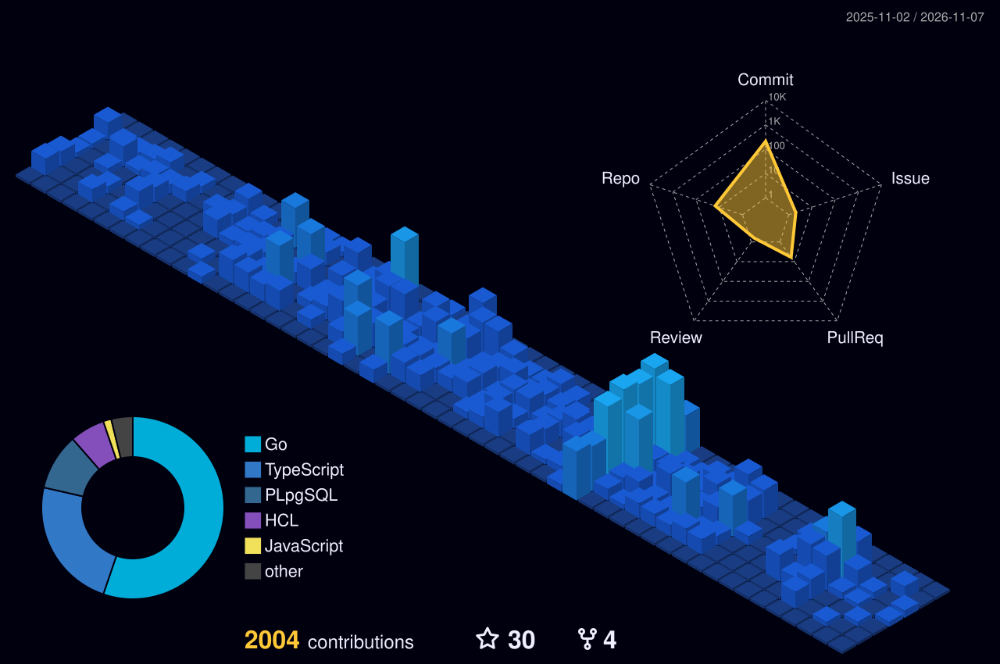

<h1 align="center">Hi 👋, I'm Giovani</h1>

  Brazilian • 23 years old • Software Engineer 
  Backend (Go/Node/Bun) • Distributed Systems • Event-driven • AWS & Azure

  
  
  
  

---

## 🧑‍💻 About Me

-  Software Engineer focused on back-end (Golang + Node.js/TypeScript/Bun)
-  **Event-driven for real** — Kafka, SQS, EventBridge, Azure Service Bus and Event Grid, built so no message gets lost and the system recovers on its own
-  **Multi-cloud** — AWS and Azure, from serverless to Kubernetes (EKS/AKS)
-  **Observability before the incident** — Datadog, OpenTelemetry, Grafana (Loki, Tempo, Prometheus) and New Relic, debugging production by trace, not by guesswork
-  **Code that survives time** — Clean Architecture, DDD, TDD, plus integration and load tests with Testcontainers
-  Mentoring junior devs and supporting the team's architecture decisions

---

## 🔧 Technologies

**Languages & Runtimes**

  

**Frameworks**

  

**Messaging & Event-driven**

  

  
  &nbsp;
  &nbsp;
  &nbsp;
  &nbsp;
  &nbsp;

**Cloud**

  

*AWS*

  
  &nbsp;
  &nbsp;
  &nbsp;
  &nbsp;
  &nbsp;
  &nbsp;
  &nbsp;
  &nbsp;
  &nbsp;
  &nbsp;
  &nbsp;
  &nbsp;
  &nbsp;
  &nbsp;
  &nbsp;
  &nbsp;
  &nbsp;

*Azure*

  
  &nbsp;
  &nbsp;
  &nbsp;
  &nbsp;
  &nbsp;
  &nbsp;
  &nbsp;
  &nbsp;
  &nbsp;
  &nbsp;
  &nbsp;
  &nbsp;
  &nbsp;
  &nbsp;
  &nbsp;
  &nbsp;

**Infra & DevOps**

  

**Databases**

  
  &nbsp;
  &nbsp;

**Observability**

  
  &nbsp;
  &nbsp;
  &nbsp;
  &nbsp;

  
  
  
  
  

**Testing, CI/CD & Tools**

  

  

**Practices**

  
  
  
  
  

---

## 📊 GitHub Stats

  

  

  
  

---

